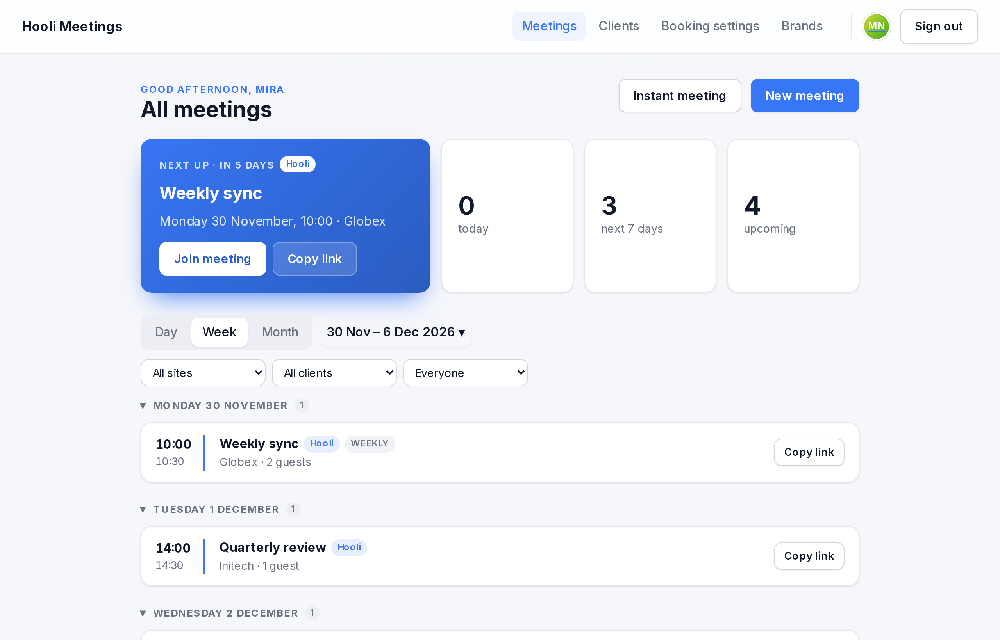
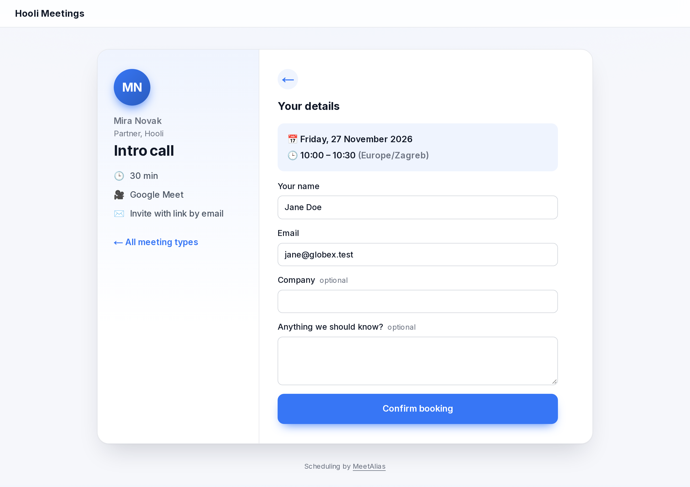
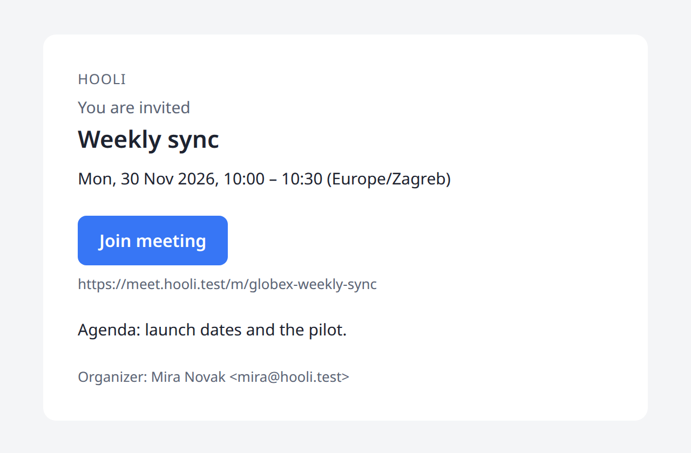

# MeetAlias

Simple, lightweight meeting scheduling for Google Meet and Microsoft Teams: readable meeting links, invitations in your own colours, booking pages, and a meeting history for every client. Open source, on your own server.

> **Coming soon.** The code will be published here shortly, under the GNU AGPL. Until then, see [meetalias.com](https://meetalias.com) and the [documentation](https://meetalias.com/docs/).

- **Readable links**: `meet.yourcompany.com/m/kickoff` instead of `meet.google.com/abc-defg-hij`.
- **One form for meetings**: the calendar event, its Meet or Teams link, and an invitation from your own Gmail or Outlook.
- **Booking pages** where clients pick a time, confirm by email, and reschedule or cancel themselves.
- **Clients**: every meeting filed under its client.
- **Brands**: one install can serve several brands, each on its own domain with its own name, colour and logo.

| A client's booking page | The invitation they get |
|---|---|
|  |  |

It is small on purpose: no workflow builders, no CRM, no payments, no tracking. Your data stays in your own database; nothing reports back to anyone.

## Hosting

Don't want to run it yourself? [Flying Penguin](https://www.flyingpenguin.tech), who make MeetAlias, host it for you on your own domain: see [pricing](https://meetalias.com/#pricing).

## License

GNU AGPL v3.0 or later.

Google, Google Meet, Google Workspace and Gmail are trademarks of Google LLC. Microsoft 365, Outlook and Microsoft Teams are trademarks of Microsoft Corporation. MeetAlias is not affiliated with or endorsed by Google or Microsoft.
